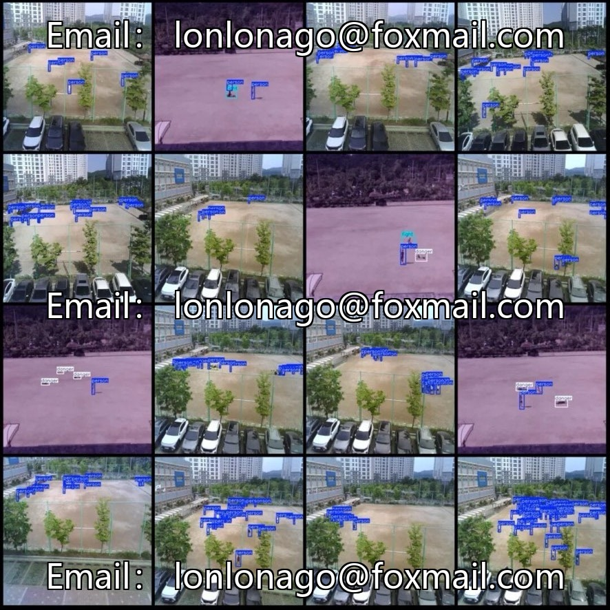
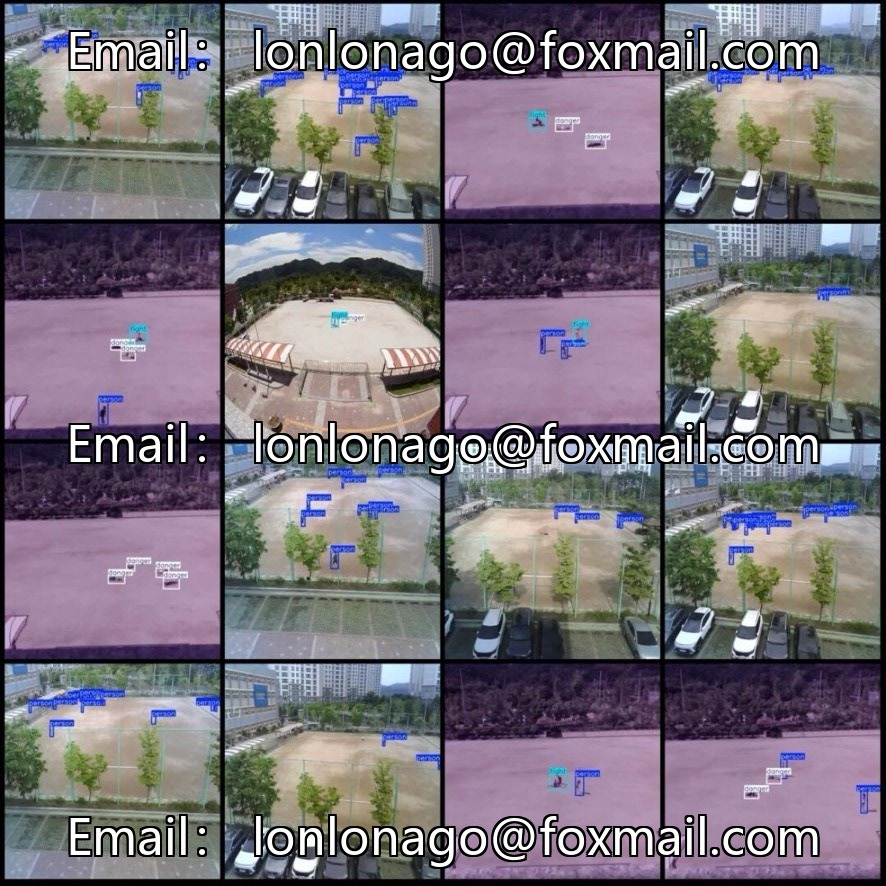

# Campus playground abnormal behavior detection dataset, including dangerous behaviors, fights, pedestrians annotation categories.

## Body

Campus playground abnormal behavior detection dataset, including three categories of annotations: dangerous behaviors, fights, and pedestrians. The images are uniformly resized to 640×640, labeled using the LabelImg tool with target bounding box annotations. There are a total of 13,491 annotated bounding boxes, 707 for dangerous behaviors, 182 for fights, and 1344 for pedestrians. Each file corresponds to the full set of images, VOC annotations, and YOLO annotations, amounting to 1433 files in total. The format is original image + xml annotation + txt annotation. The YOLO category ranking is based on labels/classes.txt, consistent with the order of the document text.

Suitable for campus smart security, real-time recognition of dangerous behaviors among students on the playground, abnormal warning models for fighting and brawling, edge-end deployment of campus AI behavior detection, YOLO/VOC object detection algorithm experiments for security, supporting mainstream target detection models (YOLOv5, YOLOv7, YOLOv8, YOLOv9, YOLOv11, Faster-RCNN, SSD, etc.).

Virtual materials, once sold, are non-refundable.
Interested friends, click "I want" to proceed.

## Images

## Payment

Here is a pay link on Stripe ( https://buy.stripe.com/3cs8yP7sY87d0vu9AB ). Please contact me lonlonago@foxmail.com after funding $89, and I will send you a complete data files , thank you!

